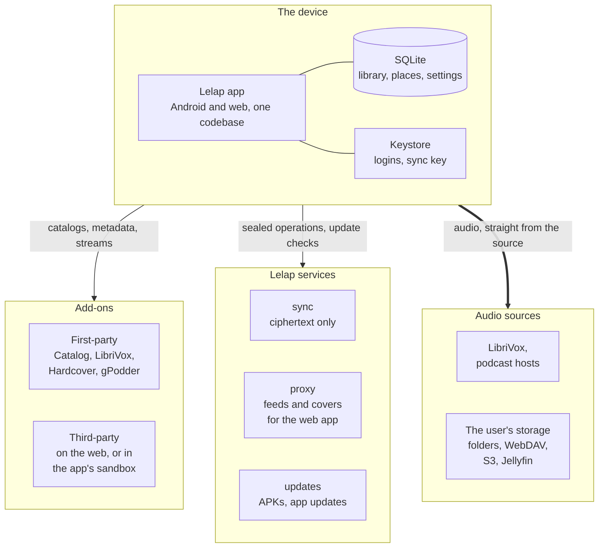
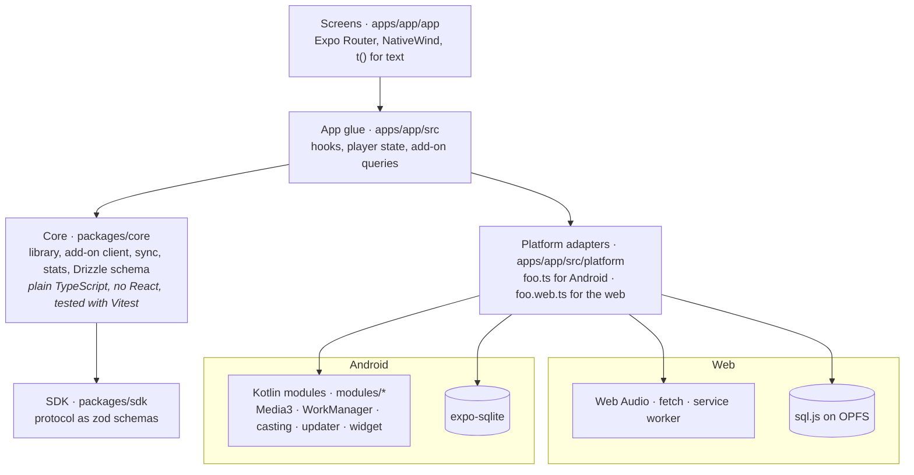
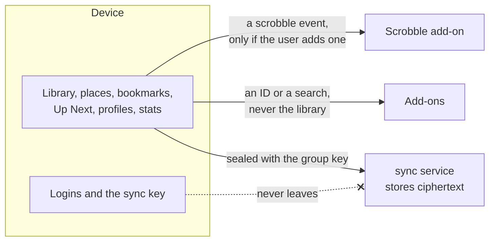
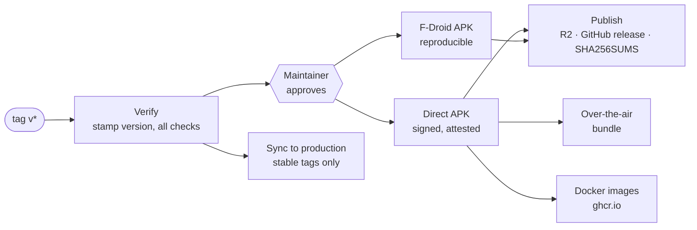

# Architecture

How Lelap fits together, on one page. Why things are this way is in [`brief.md`](brief.md); what
each milestone added is in [`milestones/`](milestones/).

## The big picture

Three kinds of places, kept apart on purpose: the device, which does the work and holds the data;
services anyone can run, which only answer questions; and the sources audio comes from, reached
directly.

- **The app does the work.** It plays, downloads, keeps the library and runs the logic on the
  device. Nothing needs an account.
- **Add-ons bring content.** Stateless HTTP services returning JSON ([protocol](../apps/site/src/pages/docs/protocol.astro),
  [SDK](../packages/sdk)); in-app add-ons run the same routes in a sandbox
  ([M38](milestones/m38.md)). The app stores only their URLs.
- **The user's own storage is built in, not an add-on:** local folders, WebDAV, S3, Jellyfin.
  Logins stay sealed on the phone (see the decision in the brief).
- **Audio never touches our servers.** Services proxy feeds, covers, chapters and transcripts for
  the web app, which browsers can't fetch across origins; never audio.

## Where code lives

| Folder              | What                                                                                                     |
| ------------------- | -------------------------------------------------------------------------------------------------------- |
| `apps/app`          | Expo app for Android and web: `app/` screens (Expo Router), `src/` hooks and platform glue               |
| `apps/site`         | Landing page and developer docs (Astro, static)                                                          |
| `packages/core`     | Domain model, Drizzle schema and migrations, library, add-on client, sync, stats, seek                   |
| `packages/sdk`      | Add-on protocol as zod schemas, `createAddon()`; MIT, on npm                                             |
| `modules/audio`     | Media3 playback service: queue of parts, speed, focus, sleep timer, sound effects                        |
| `modules/library`   | Folder access, tags and chapters for local files                                                         |
| `modules/download`  | WorkManager downloads with Wi-Fi and charging rules                                                      |
| `modules/cast`      | UPnP, an own Cast v2 client, FCast, and a LAN file server                                                |
| `modules/updater`   | In-app APK updates through PackageInstaller                                                              |
| `modules/widget`    | Home screen widget and Quick Settings tile                                                               |
| `modules/bluetooth` | Connected audio devices, their battery, car detection                                                    |
| `services/*`        | Hono services: `catalog` (Catalog, LibriVox, Hardcover, gPodder), `proxy`, `sync`, `updates`, `template` |
| `docker/`           | Node entries, Dockerfiles and compose for self-hosting                                                   |
| `examples/`         | Add-on samples in Node, Python and in-app JavaScript; tested in CI                                       |
| `scripts/`          | Release helpers for the tag workflow                                                                     |

### Layers inside the app

Each layer only talks to the one below it, so the same screens and logic run on Android and in the
browser, and native code stays behind small APIs.

Platform differences live in sibling files: `foo.ts` for Android, `foo.web.ts` for the web.
Native modules have a JavaScript API in `modules/<name>/src`; the app reaches them through
`apps/app/src/platform/`.

## Data

- **One SQLite database per device**, schema in `packages/core/src/schema.ts`, migrations generated
  by `drizzle-kit` (never written by hand). Most tables are per profile.
- **Secrets** (server passwords, the sync key) are sealed with a key from the Android Keystore
  (`expo-secure-store`) and left out of backups.
- **Sync** pushes changed rows as operations sealed with XChaCha20-Poly1305; the server stores a
  group's log under a random ID and never sees the key. Details: [brief](brief.md#sync-m7).
- **Downloads** are files in the app's storage, tracked in the database; the queue runs in
  WorkManager so it survives the app closing.

### What leaves the device

## Hosts

| Host                | What                                        | Runs on            |
| ------------------- | ------------------------------------------- | ------------------ |
| `lelap.app`         | Landing page and `/docs`                    | Cloudflare Pages   |
| `listen.lelap.app`  | The web app (PWA)                           | Cloudflare Pages   |
| `dl.lelap.app`      | APKs, `latest.json`, `beta.json`, OTA files | R2                 |
| `updates.lelap.app` | Over-the-air update manifests               | Worker + R2        |
| `catalog.lelap.app` | First-party add-ons                         | Worker + Cache API |
| `proxy.lelap.app`   | Feeds, covers, transcripts for the web app  | Worker + Cache API |
| `sync.lelap.app`    | Encrypted sync logs                         | Worker + D1        |

Every host comes from configuration (`LELAP_DOMAIN`), so a fork or a self-hoster changes no
source. The same services run in Docker (`ghcr.io/lelap-app/*`) with SQLite and disk instead of
D1 and R2.

## Pipelines

| Workflow       | When                                      | What                                                                                       |
| -------------- | ----------------------------------------- | ------------------------------------------------------------------------------------------ |
| `ci.yml`       | Every pull request and push to `main`     | Format, lint, type-check, test, build; Kotlin unit tests when native code changes          |
| `site.yml`     | Push to `main` touching the site          | Builds and deploys `lelap.app`; variables `LELAP_BETA` and `LELAP_RELEASED` pick its state |
| `web.yml`      | Push to `main` touching the app           | Builds and deploys `listen.lelap.app`                                                      |
| `services.yml` | Push to `main` touching services          | Deploys the Workers; sync goes to staging                                                  |
| `sdk.yml`      | Push to `main` changing the SDK's version | Publishes `@lelap/sdk` to npm with provenance (environment `npm`)                          |
| `release.yml`  | Tag `v*`                                  | See below                                                                                  |

A release tag (`v1.2.3`, or `v1.2.3-beta.4` for a beta):

1. **Verify:** stamps the version into `app.json`, runs every check.
2. **Approval:** jobs in the `release` environment wait for a maintainer; it holds the signing
   keys and only tags can use it.
3. **Build:** the direct APK and the F-Droid APK (no self-updates, reproducible) in parallel, each
   signed and attested.
4. **Publish:** APKs to R2 (`beta.apk`, and `latest.apk` for stable) and a GitHub release with
   `SHA256SUMS`; `beta.json` or `latest.json` goes last, so it never points at a missing file.
5. **Over the air:** the JavaScript bundle for this native build, signed, for the `beta` (and
   `production`) channel.
6. **Images:** five multi-arch images on `ghcr.io`.
7. **Sync to production:** stable tags only.

Jobs that hold secrets use no caches, so a poisoned cache can't reach a release;
[M54](milestones/m54.md) plans a cached build with separate signing.

## How a change reaches people

- **JavaScript only:** merged to `main`, the web app has it within minutes; Android gets it with
  the next tag as an over-the-air update, applied on the next start.
- **Native code:** a new APK; the app's updater offers it from `latest.json` or `beta.json`.
- **Add-ons:** deploy on their own schedule; the app refreshes manifests on start.
